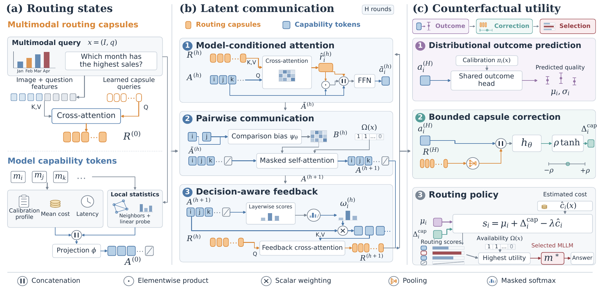

<div align="center">

# LatentRouter

**Can We Choose the Right Multimodal Large Language Model Before Seeing Its Answer?**

[](https://neurips.cc/Conferences/2026) [](https://www.python.org/) [](LICENSE)

</div>

This is the official repository of our NeurIPS 2026 paper **"LatentRouter: Can We Choose the Right Multimodal Large Language Model Before Seeing Its Answer?"**

LatentRouter treats multimodal LLM routing as counterfactual utility prediction: before any candidate is called, it estimates how every available MLLM would answer the same image-question query and routes to the one with the best predicted quality-cost tradeoff.

<p align="center">
  
</p>

## Method

For a query $x$ and a candidate pool $\mathcal{M}=\{m_1,\ldots,m_K\}$ with available models $\Omega(x)$:

1. **Multimodal routing capsules.** The question and image embeddings are projected into query tokens, and $C$ learned capsule queries cross-attend to them, giving the routing capsules $R^{(0)}(x)$.
2. **Model capability tokens.** Each candidate is represented by $a_i^{(0)}=\phi([p_i;\bar c_i;\ell_i;b_i(x)])$: its calibration profile $p_i$ (overall and per-slice accuracy, pairwise win rates against the other candidates, model metadata), average normalized cost $\bar c_i$ on the training split, latency $\ell_i$, and query-specific calibration statistics $b_i(x)$. The $k$ training queries most similar to $x$ form a query-specific slice; the accuracy of $m_i$ on this neighborhood, shrunk toward its overall accuracy, is combined with a linear-probe estimate of its accuracy on $x$ into the calibrated estimate $\pi_i(x)$.
3. **Latent communication.** $H$ layers in which each model token reads the capsules from its own perspective, model tokens compare with each other through availability-masked self-attention with a pairwise comparison bias, and the capsules receive decision-aware feedback weighted toward the candidates near the decision boundary.
4. **Distributional outcome prediction.** The final model token predicts the outcome distribution relative to the calibration estimate, $\mu_i=\mathrm{sigmoid}(\mathrm{logit}\,\pi_i(x)+g_\theta(a_i^{(H)}))$ with $\sigma_i^2=\mu_i(1-\mu_i)$ for answer quality in $[0,1]$.
5. **Bounded capsule correction.** $\tilde\mu_i=\mu_i+\rho\tanh(h_\theta([a_i^{(H)};\mathrm{Pool}(R^{(H)})]))$.

The routing score is $s_i(x)=\tilde\mu_i(x)-\lambda\,\hat c_i(x)$, where $\hat c_i(x)$ is a ridge-regression estimate of the cost of answering $x$ with $m_i$. Training minimizes
$\mathcal{L}=\mathcal{L}_{\mathrm{dist}}+\alpha\mathcal{L}_{\mathrm{pair}}+\beta\mathcal{L}_{\mathrm{list}}+\gamma\mathcal{L}_{\mathrm{util}}+\eta\mathcal{L}_{\mathrm{res}}$
over the available models of each query. The outcome head is shared across model tokens and unavailable models are masked, so the same router scores any subset of the pool.

## Installation

From the repository root (Python 3.10 or newer):

```bash
pip install -e ".[features]"
```

## Data

### MMR-Bench

```bash
huggingface-cli download gh0stHunter/MMR-Bench --repo-type dataset --local-dir data/mmr_bench
tar -xzf data/mmr_bench/images.tar.gz -C data/mmr_bench
python scripts/extract_mmr_features.py --root data/mmr_bench --output data/mmr_bench/clip_vit_b32_openai.npz
```

The features are the OpenCLIP ViT-B/32 (`openai`) question and image embeddings used by MMR-Bench.

### VL-RouterBench

Build the benchmark with the official pipeline (Steps 1-3, and Step 5 for the BGE-M3 question embeddings; see the VL-RouterBench README for its environment):

```bash
git clone https://github.com/K1nght/VL-RouterBench.git data/vl_routerbench
cd data/vl_routerbench
huggingface-cli download KinghtH/VL-RouterBench vlm_router_data.tar.gz --repo-type dataset --local-dir .
tar -xzf vlm_router_data.tar.gz
bash scripts/run_step1_build_benchmark.sh
bash scripts/run_step2_calculate_tokens.sh
bash scripts/run_step3_build_matrices.sh
VISION_ENCODER=google/siglip-large-patch16-384 bash scripts/run_step5_extract_features.sh
cd ../..
```

Then encode the images of all samples with SigLIP-L/16-384:

```bash
python scripts/extract_vl_image_features.py --vl-repo data/vl_routerbench --root data/vl_routerbench \
    --tsv-dir data/vl_routerbench/vlm_router_data/TSV_images
```

## Training and evaluation

```bash
latentrouter --config configs/mmr_bench.yaml --seed 0 1 2
latentrouter --config configs/vl_routerbench.yaml --seed 0 1 2
```

Each run writes `runs/<benchmark>/seed<k>/metrics.json` and the trained router `router.pkl`.

- **MMR-Bench** uses the official split (20% of the queries for training, 80% for test, `random_state` = seed). The hidden dimension and learning rate are selected by nAUC on a held-out quarter of the training split. Test queries are scored with the official MMR-Bench cost-threshold curve on $(\tilde\mu_i,\hat c_i)$ and reported as nAUC, Ps and QNC.
- **VL-RouterBench** uses the official train/dev/test split. The router is trained on train with early stopping on dev, and $\lambda$ is selected on dev by Rank Score (performance-cost) and by accuracy (performance-oriented). Test results report accuracy, average cost and Rank Score ($\beta=0.1$).

All hyperparameters are listed in the config files.

## Using the router

```python
from latentrouter import LatentRouter, RoutingData
from latentrouter.benchmarks import vl_routerbench

data = vl_routerbench.load("data/vl_routerbench")
router = LatentRouter(data["train"].model_ids, seed=0).fit(data["train"], data["dev"])

prediction = router.predict(data["test"])          # mu, sigma and mu_tilde, each (n, K)
choice = router.route(data["test"], lam=0.1)       # index of the selected model per query
router.save("vl_router.pkl")
```

Any routing dataset can be wrapped in a `RoutingData` with query features, per-model quality and cost, and an optional availability mask. At deployment only the query features (computed the same way as for training) and the available pool are needed:

```python
queries = RoutingData(sample_ids=ids, model_ids=router.model_ids, features=x, availability=available)
choice = router.route(queries, lam=0.1)
```

## Repository structure

```text
configs/                        hyperparameters for MMR-Bench and VL-RouterBench
scripts/                        feature extraction for both benchmarks
src/latentrouter/
  data.py                       RoutingData
  profiles.py                   calibration profiles p_i
  evidence.py                   query-specific calibration statistics b_i(x)
  network.py                    routing capsules, latent communication, outcome head, bounded correction
  losses.py                     training objective
  cost.py                       per-query cost estimator
  router.py                     LatentRouter
  benchmarks/                   data loading and official evaluation protocols
  cli.py                        command-line entry point
tests/
```

## Citation

```bibtex
@inproceedings{cheng2026latentrouter,
  title     = {LatentRouter: Can We Choose the Right Multimodal Large Language Model Before Seeing Its Answer?},
  author    = {Cheng, Xueqi and Dong, Yushun},
  booktitle = {Advances in Neural Information Processing Systems},
  year      = {2026}
}
```

## License

MIT
